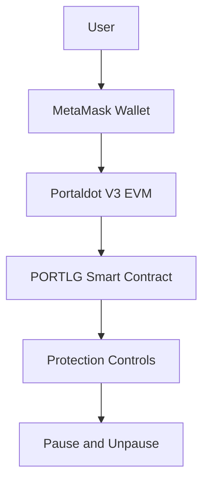

# PORTLG Architecture

## System Overview

PORTLG is a smart contract security prototype on Portaldot V3 Testnet.

## Architecture Diagram

## Components

- **User:** Initiates contract interactions.
- **MetaMask:** Signs blockchain transactions.
- **Portaldot V3 EVM:** Executes smart contracts.
- **PORTLG:** Provides security and protection controls.

## Network

- Chain ID: 420420777
- Smart Contract: 0x81a4548fA436440641120aEE326A1948bdC558a4

## Current Status

Prototype developed for Portaldot Hacker House 2026. On-chain verification and functional demonstration are pending.
