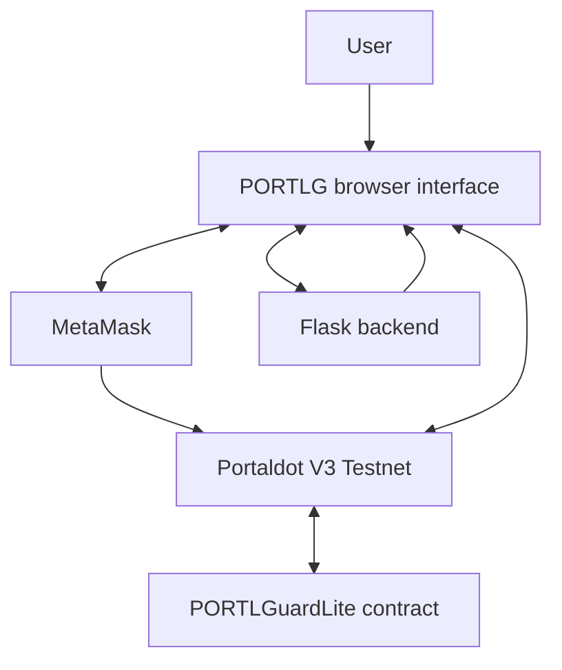

# PORTLG Wallet

**A MetaMask-connected wallet interface and smart-contract security prototype for Portaldot V3 Testnet.**

PORTLG brings together a browser-based wallet interface, a Flask backend for preparing transactions, and the deployed `PORTLGuardLite` smart contract. MetaMask remains responsible for account access and transaction signing.

> **Project status:** Prototype on Portaldot V3 Testnet. This repository documents the implemented functionality and its current limitations; it does not claim to be a production wallet or an independently audited security product.

---

## 1. Project overview

PORTLG explores how a wallet interface can interact with an EVM-compatible test network while exposing basic contract-level controls.

The current implementation focuses on:
- Connecting a browser interface to MetaMask.
- Preparing transactions through the Flask backend.
- Interacting with the deployed `PORTLGuardLite` contract.
- Reading the contract's owner and paused state.
- Allowing the contract owner to pause or unpause protected actions.
- Running automated tests against an isolated local EVM and backend test environment.

## 2. How PORTLG works

The application follows this interaction flow:

1. A user opens the PORTLG interface and connects MetaMask.
2. The interface requests the required account and network information.
3. The backend prepares transaction data when the application needs it.
4. MetaMask presents the transaction for the user to review and approve.
5. The approved transaction is submitted to the Portaldot V3 Testnet.
6. The interface can read the contract state and display the result.

**Signing and custody:** MetaMask signs transactions. The backend does not store private keys or seed phrases.

## 3. System architecture



Main components:

| Component | Responsibility |
|---|---|
| Browser interface | Wallet interaction and user-facing controls |
| MetaMask | Account connection, transaction review and signing |
| Flask backend | API endpoints and unsigned transaction preparation |
| Portaldot V3 Testnet | EVM-compatible test network |
| PORTLGuardLite | Owner-controlled pause state and protected action |

For the detailed component design and trust boundaries, see [Architecture](docs/ARCHITECTURE.md).

## 4. Smart contract

**Contract:** `PORTLGuardLite`

**Deployed address:** `0x44406CD3e7ccE420c316D015FEE74303F16629E5`

| Function | Purpose |
|---|---|
| `owner()` | Reads the contract owner |
| `paused()` | Reads whether protected actions are paused |
| `pause()` | Allows the owner to pause protected actions |
| `unpause()` | Allows the owner to resume protected actions |
| `protectedAction()` | Executes the protected action when the contract is not paused |

The contract emits events including `Paused`, `Unpaused` and `SecurityAlert`.

**Important:** `SecurityAlert` is an event emitted by the contract during the protected action. It is not evidence of autonomous threat detection, and the contract does not automatically pause itself when a threat is detected.

### Network details

| Setting | Value |
|---|---|
| Network | Portaldot V3 Testnet |
| Chain ID | `420420777` |
| RPC endpoint | [Portaldot V3 RPC](https://test-evm-rpc-v3.portaldot.dev) |
| Contract | `PORTLGuardLite` |
| Address | `0x44406CD3e7ccE420c316D015FEE74303F16629E5` |
| Deployment block | `200580` |
| Deployment transaction | `0x6115a0880f1822ba7b43c5b0461323eaebab701f12ce22b81325a3d2b1e5d879` |
| Deployment status | Success (`0x1`) |
| Deployer | `0xde8547c35e4eb0cf3850a3f67def1defd4d43594` |

**Deployment evidence:** The deployment transaction was independently checked through the Portaldot V3 RPC in Google Colab. Its successful receipt (`0x1`) matches this contract address and block `200580`; its input begins with contract-creation bytecode (`0x60806040`). The Portaldot Scanner also shows the `revive(Instantiated)` event for this contract at block `200580`.

**Separate contract interaction:** Block `200641` contains a `revive(ContractEmitted)` event for this contract, corresponding to the later `protectedAction()` interaction and its `Protected action executed` alert. It is not the deployment block or deployment transaction.

See [Network configuration](docs/NETWORK.md) and [Deployment record](docs/DEPLOYMENT.md) for further details.

## 5. Repository structure

The repository is grouped by implementation area and supporting evidence:

```text
PORTLG/
├── index.html                 # Browser demonstration entry point
├── wallet.js                  # Browser-side wallet interaction
├── contracts/
│   └── PORTLGuardLite.sol     # Solidity contract
├── frontend/                  # Frontend application
├── backend/                   # Flask API
├── scripts/                   # Contract compilation and deployment utilities
├── tests/                     # Automated tests
│   └── README.md              # Test setup and scope
├── docs/
│   ├── index.html             # Documentation directory
│   ├── ARCHITECTURE.md        # System design and data flow
│   ├── NETWORK.md             # Testnet configuration
│   ├── DEPLOYMENT.md          # Deployment record
│   ├── SECURITY.md            # Security model and limitations
│   ├── DEMO.md                # Demonstration procedure
│   └── TEST_REPORT.md         # Automated test results
└── requirements.txt           # Python dependencies
```

Open the [documentation directory](docs/index.html) to browse the supporting project documents.

## 6. Run locally

Use Python 3 in a development environment.

```bash
pip install -r requirements.txt
python scripts/compile_contract.py
python -m unittest discover -s tests -p 'test_*.py' -v
```

The commands above install the Python dependencies, compile the contract and run the automated test suite. Refer to the individual documentation files for environment configuration and application-specific startup instructions.

## 7. Testing and evidence

The repository includes automated contract and backend tests. The documented test report records **11 passed, 0 failed and 0 skipped** in the reported test run.

Tests use an isolated local EVM and mocked or test backend components. They do not constitute a full end-to-end test against the live Portaldot V3 Testnet and do not change the deployed contract.

- [Automated test report](docs/TEST_REPORT.md)
- [Test instructions](tests/README.md)
- [GitHub Actions test run](https://github.com/blueyellow1/PORTLG/actions/runs/42174663605)

## 8. Security model and current limitations

- MetaMask retains control of account access and transaction signing.
- The backend prepares unsigned transaction data; it does not custody user keys.
- Contract pause and unpause operations are restricted to the contract owner.
- The current contract does not provide autonomous threat detection or automatic incident response.
- The prototype has not undergone an independent security audit.
- It is a testnet prototype and must not be used to protect real funds.

Native Assets, NFTs, guardians and multi-network support are not part of the current implementation.

Read the full [Security model and limitations](docs/SECURITY.md) before evaluating the prototype.

## 9. Commercial roadmap: Paid Access (planned)

Paid Access is a proposed future commercial feature. **It is not implemented or enabled in the current demo**, and the current wallet does not require a trial, credits or a payment to use its existing functions.

The planned model is:

- **Free trial:** 7 days for a new eligible wallet.
- **Starter allowance:** 10 introductory usage credits.
- **Top-ups:** 1 credit planned to cost 5 tPOT.
- **Payment network:** Portaldot, with payment approval through MetaMask.
- **Usage:** A credit would be consumed only after an eligible protected action is successfully confirmed on-chain.
- **Payment verification:** A future release would verify the Portaldot transaction before adding credits to the wallet account.

The intended commercial flow is for users to connect the same MetaMask wallet, receive the trial and starter credits, then purchase additional credits with tPOT when their free allowance is used. The exact eligibility, pricing and payment-verification rules will be finalized and tested before launch.

For clarity, the Paid Access button in the current website is informational only. It displays a coming-soon message; it does not start a trial, deduct credits, request payment or restrict the protected action. This roadmap does not modify the deployed PORTLGuardLite contract.

---

## 10. Project links

- **[Open the PORTLG browser demonstration](https://blueyellow1.github.io/PORTLG/)**
- **[Browse the source code](https://github.com/blueyellow1/PORTLG)**
- **[Browse project documentation](docs/index.html)**

---

*PORTLG Wallet — a testnet prototype demonstrating MetaMask connectivity, transaction preparation and owner-controlled smart-contract protection.*
